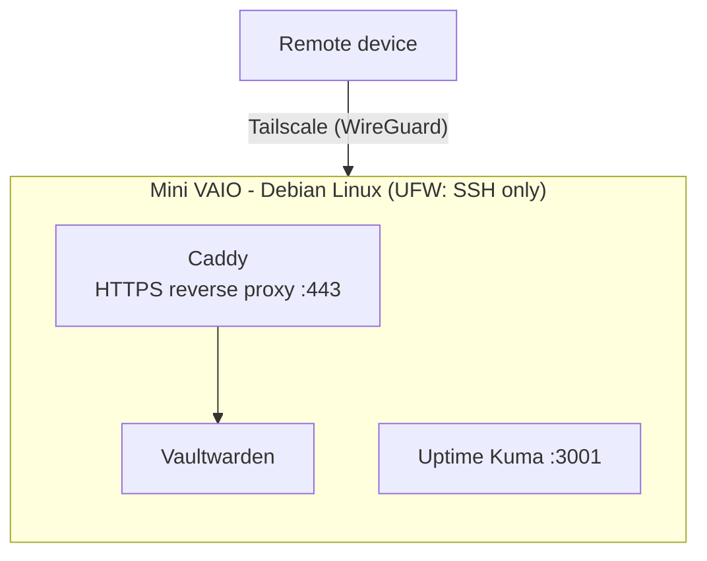

# Mini VAIO Homelab

A lightweight self-hosted homelab running on an old VAIO laptop with only 2 GB of RAM.

This project is a practical environment to study and experiment with Linux, Docker, networking, monitoring, security, backups and DevOps concepts using limited hardware. Instead of relying only on theory, the goal is to build, operate and document real services.

---

## Hardware

| Component        | Specification |
| ---------------- | ------------- |
| Device           | VAIO Laptop   |
| RAM              | 2 GB          |
| Storage          | 500 GB HDD    |
| Architecture     | x86_64        |
| Operating System | Debian Linux  |

Because of the limited resources, one of the main goals is to keep the infrastructure lightweight and efficient.

---

## Services

| Service | Role |
| --- | --- |
| **Docker / Docker Compose** | Container runtime and service definition |
| **Tailscale** | Private remote access (VPN), no public port forwarding |
| **Caddy** | Reverse proxy providing HTTPS, using certificates issued through Tailscale |
| **Vaultwarden** | Self-hosted password manager compatible with Bitwarden clients |
| **Uptime Kuma** | Service availability and uptime monitoring |

---

## Architecture



- Remote devices reach the server through the Tailscale network.
- Caddy terminates HTTPS for Vaultwarden and forwards requests to the container over a private Docker network. Vaultwarden does not publish any port on the host.
- The HTTPS certificate for the `*.ts.net` name is obtained from the local Tailscale daemon (the `tailscaled` socket is mounted into the Caddy container).
- Uptime Kuma runs in its own Compose project and is monitored through its web interface.

---

## Repository structure

```
.
├── LICENSE
├── README.md
├── uptime-kuma/
│   ├── docker-compose.yml
│   └── data/                  # local data (ignored by Git)
└── vaultwarden/
    ├── Caddyfile
    ├── docker-compose.yml
    ├── .env.example           # template (copy to .env)
    ├── .env                   # real values (ignored by Git)
    └── data/                  # vault database and keys (ignored by Git)
```

Each service lives in its own folder with its own `docker-compose.yml`, so they can be started, updated and removed independently.

> **Note:** `data/` folders and `.env` files are listed in `.gitignore`. They contain the Vaultwarden database and keys, Uptime Kuma's database and environment-specific values, and must never be committed.

---

## Getting started

**Prerequisites:** Debian (or another Linux), Docker with the Compose plugin, and Tailscale installed and logged in. In the Tailscale admin console, enable **MagicDNS** and **HTTPS certificates**.

1. Clone the repository:

```bash
git clone https://github.com/nicolaslourenc2/mini-vaio-homelab.git
cd mini-vaio-homelab
```

2. Configure Vaultwarden + Caddy. Set the machine's Tailscale name (for example `my-server.my-tailnet.ts.net`):

```bash
cd vaultwarden
cp .env.example .env
nano .env          # DOMAIN=<machine>.<tailnet>.ts.net
docker compose up -d
```

3. Start Uptime Kuma:

```bash
cd ../uptime-kuma
docker compose up -d
```

4. Access (from a device connected to the same tailnet):

| Service | URL |
| --- | --- |
| Vaultwarden | `https://<machine>.<tailnet>.ts.net` |
| Uptime Kuma | `http://<tailscale-ip>:3001` |

---

## Monitoring

**Current:** Uptime Kuma checks the availability of the services (for example, the Vaultwarden HTTPS endpoint).

**Planned:**

- TLS certificate validity
- Docker containers
- Disk, RAM and CPU usage
- HDD SMART health
- Server temperature

Lightweight Bash scripts may be used to send system metrics to Uptime Kuma Push Monitors.

---

## Backup

Backup implementation is **planned** and is the next priority, since the server stores a password vault.

Technologies being evaluated:

- Restic
- Scheduled backups with cron
- Encrypted backups
- Off-site backup storage

The strategy will prioritize low resource usage because the server only has 2 GB of RAM.

---

## Security

**Current practices**

- UFW firewall allowing only SSH (port 22) on the host
- Remote access only through Tailscale
- HTTPS for Vaultwarden with Caddy and Tailscale certificates
- Vaultwarden is not published on the host; it is only reachable through Caddy
- Services run in containers
- Secrets and data kept out of the repository (`.gitignore`, `.env`)

**Known limitation:** Docker publishes ports directly through iptables, which can bypass UFW rules. Ports published by containers (Caddy `80/443` and Uptime Kuma `3001`) may therefore be reachable from the local network even though UFW only allows SSH. Mitigation is in the roadmap below.

---

## Roadmap

- [x] Docker and Docker Compose
- [x] Remote access with Tailscale
- [x] HTTPS reverse proxy with Caddy (Tailscale certificates)
- [x] Vaultwarden
- [x] Uptime Kuma
- [ ] Encrypted, automated backups (restic + cron, off-site copy)
- [ ] Bind published ports to the Tailscale IP (avoid the UFW/Docker bypass) and verify with a port scan from another network
- [ ] Disable Vaultwarden public sign-ups after creating the account
- [ ] SSH hardening (key-only authentication, fail2ban)
- [ ] Pin image versions and add resource limits for the 2 GB RAM host
- [ ] Extended monitoring (disk, RAM, CPU, SMART, temperature) with Push Monitors

---

## Goals

This homelab is used to develop practical knowledge in:

- Linux administration
- Docker and Docker Compose
- Networking
- Reverse proxies
- HTTPS / TLS
- VPN / overlay networks
- Monitoring
- Backup strategies
- Bash scripting
- Infrastructure troubleshooting
- DevOps practices

---

## Why this project?

The goal is not to build a large production infrastructure. The challenge is the opposite: **how much useful infrastructure can be built on an old laptop with only 2 GB of RAM?**

This constraint encourages lightweight tools, resource optimization and a better understanding of how each service consumes system resources. The project also serves as a practical portfolio documenting my progress with Linux, infrastructure and DevOps.

---

## Status

Work in progress.
